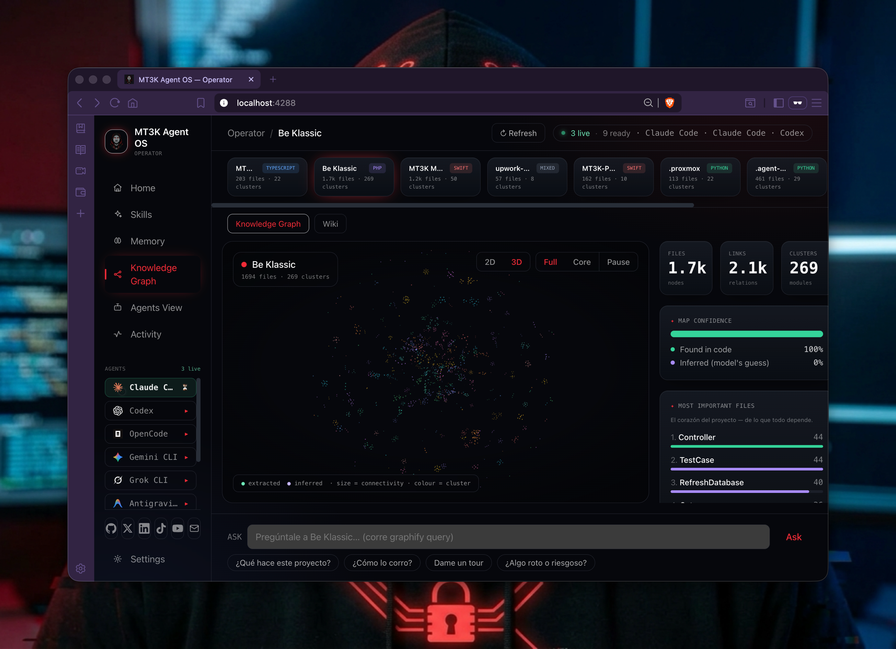
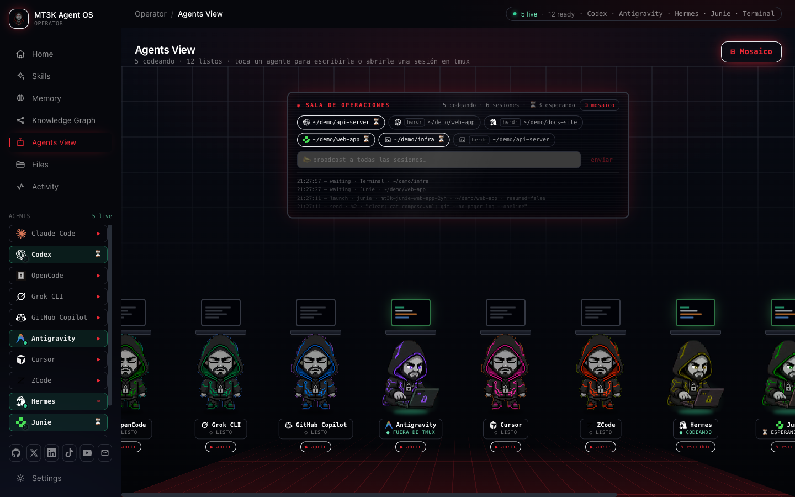
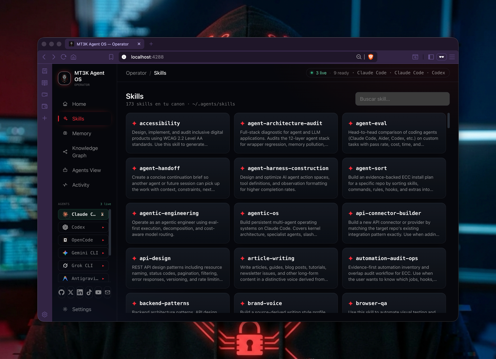
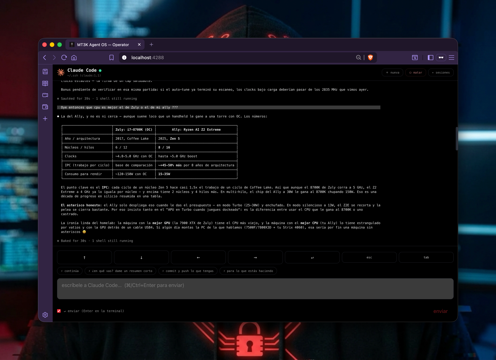
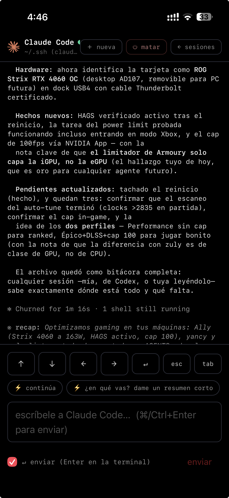
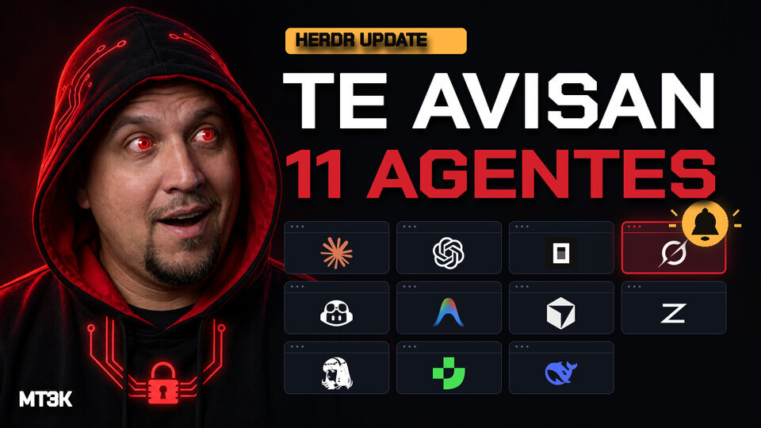
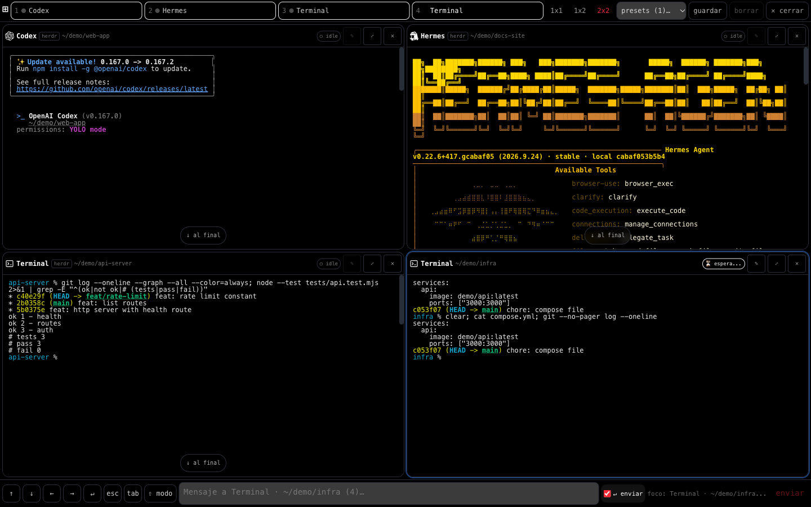
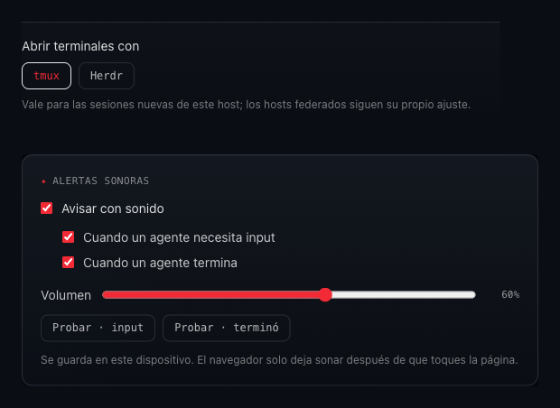

# MT3K Agent OS

<p>
  
  
  
  <a href="https://www.patreon.com/MT3K"></a>
</p>

A local, file-based **agentic operating system** + a visual **knowledge-graph dashboard** for every repo you map with [graphify](https://github.com/safishamsi/graphify).

Your "shared brain": each project is graphed once, then the panel shows its knowledge graph, god nodes, map confidence, token savings, and an in-panel wiki — and you can ask questions that run `graphify query` live. No external DB, no vector store, no cloud — JSON + markdown on disk.

<p align="center">
  
</p>

<table align="center">
  <tr>
    <td align="center"></td>
    <td align="center"></td>
  </tr>
  <tr>
    <td align="center"><sub>Agents View — the mission-control wall</sub></td>
    <td align="center"><sub>Skills — your whole canon, searchable</sub></td>
  </tr>
  <tr>
    <td align="center"></td>
    <td align="center"></td>
  </tr>
  <tr>
    <td align="center"><sub>Live terminal in the browser (SSE)</sub></td>
    <td align="center"><sub>…and from your phone</sub></td>
  </tr>
</table>

## What's new — Herdr Update (November 2026)

86 commits, 150 files and +22,486 lines since `b46b1ac` (27 Oct 2026), measured at `4450812`.

- **Herdr terminals** — the panel lists, reads, types into, launches and closes
  [Herdr](https://herdr.dev) terminals next to your tmux ones, in colour, marked with a `herdr`
  badge. Settings → **Abrir terminales con** (`tmux` | `Herdr`) picks where new sessions open. See
  [Herdr terminals](#herdr-terminals).
- **Alerts** — a sound plus a toast in the browser when an agent **needs input** or **finished**
  (Settings → **Alertas sonoras**, off by default, per device), and an optional phone push through
  [ntfy](https://ntfy.sh). See [Alerts](#alerts).
- **11 agents + Terminal** — **Hermes** and **Junie** are new.
- **Terminal mosaic** — several live sessions on one screen (2x2, 1x2 or 1x1 with a slot strip),
  each with its own status; also on foldables and tablets.
- **Clickable paths and branches** — file paths and branch names printed in a terminal are links:
  a path opens in Files (with a hover preview on desktop), a branch opens on GitHub when it is pushed.

Herdr is an independent project ([herdr.dev](https://herdr.dev)); MT3K Agent OS is not affiliated
with it.

<p align="center">
  <a href="https://youtu.be/ZGUh0XgPQKw"></a><br>
  <sub>▶ Trailer (45 s). The interface in the trailer is a motion recreation; the screenshots below are the real panel.</sub>
</p>

<table align="center">
  <tr>
    <td align="center"></td>
    <td align="center"></td>
  </tr>
  <tr>
    <td align="center"><sub>Mosaic: Herdr and tmux sessions side by side, in colour</sub></td>
    <td align="center"><sub>Settings: where sessions open, and sound alerts</sub></td>
  </tr>
</table>

## Support

MT3K Agent OS is free and open source (MIT). If it's useful to you, [**become a patron**](https://www.patreon.com/MT3K) — patrons ($5+) get early-access posts on new MT3K releases and a voice in what ships next.

## Layout

```
CLAUDE.md            kernel — routing + agent registry
agents/              specialist agents (e.g. @mapper)
data/
  projects.example.json  template — the panel reads projects.json (or falls back to empty)
  projects.json          the repos the panel tracks — GITIGNORED, host-local, never committed
  logs/                  file-based memory (sessions, queries, refreshes) — GITIGNORED
scripts/
  build-data.mjs     ingests each repo's graphify-out/ → panel data
  server.mjs         local API (query / refresh / discover / agents) + serves the panel
panel/               Vite + React + TS + Tailwind dashboard
```

## Run

```bash
# 1. build the dashboard
pnpm --dir panel install
pnpm --dir panel build

# 2. start the OS (serves panel + API on one port)
node scripts/server.mjs        # → http://localhost:4288
```

For development with hot-reload: `pnpm --dir panel dev` (Vite :5273, proxies `/api`) **+** `node scripts/server.mjs`.

## Start on boot (autostart)

```bash
./scripts/install-service.sh install                 # open LAN panel
./scripts/install-service.sh install --token SECRET  # with API auth (recommended)
./scripts/install-service.sh status | uninstall
```

- **macOS** → a LaunchAgent (`~/Library/LaunchAgents/com.mt3k.agent-os.plist`): starts at login,
  restarts if it dies, logs to `~/Library/Logs/mt3k-agent-os.log`. It pins `TMPDIR` to your real
  user temp dir — without that, a launchd-run server can't see your tmux sessions.
- **Linux** → a systemd unit (`/etc/systemd/system/mt3k-agent-os.service`, needs sudo): starts at
  boot, `Restart=always`, and `KillMode=process` so service restarts never kill the agents' tmux
  sessions.

Uninstalling stops the panel only — agent tmux sessions keep running.

## Install with an agent

Hand this prompt to a coding agent (Claude Code, Codex, Cursor `cursor-agent`, …) to set it up from scratch on a clean machine:

```text
Set up MT3K Agent OS on this machine. Steps:

1. Verify prerequisites are on PATH: node ≥22, pnpm, tmux, git, and graphify
   (https://github.com/safishamsi/graphify). Install whatever is missing, then stop and
   tell me if you can't.
2. Clone the repo and cd into it:
   git clone <REPO_URL> MT3K-AGENT-OS && cd MT3K-AGENT-OS
   (a fresh clone is clean by design: private data is gitignored and ships as
   *.example.json templates — nothing to reset)
3. Build the dashboard:  pnpm --dir panel install && pnpm --dir panel build
4. Start the OS:  node scripts/server.mjs   (serves panel + API on http://localhost:4288)
   — or install it as an autostart service:  ./scripts/install-service.sh install
5. Verify it starts empty: GET /data/manifest.json must return {"projects":[]}.
6. Report back: the URL, and the agent CLIs it detected at GET /api/agents
   (id + online/running/launchable for each).

Then tell me how to add my first repo: graph it with `graphify .` inside the repo, then
use ＋ Add a project in the panel (or add it to data/projects.json and run
node scripts/build-data.mjs).
```

> Deploying to a shared/remote host instead of your own machine? See
> **[Deploying to another host](#deploying-to-another-host)** — set `MT3K_TOKEN` there.

## Agents View

The **Agents View** (and the sidebar list) shows every detected agent CLI. Tap one to:

- **✎ write** — if it's already running in a tmux pane, open its live terminal (SSE-streamed) and type
  into it, with an arrow-key pad for TUI menus, one-tap **quick prompts** (`data/macros.json`), and
  **⏻ kill** to end a session. **＋ nueva** spawns parallel sessions of the same agent. The **📎**
  button (or pasting into the compose box) attaches a screenshot, PDF, or audio file: it's saved under
  `data/uploads/` on the host where the agent lives (federation included) and its path is composed
  into the message so the CLI reads it directly. Max 25MB; files are swept after 7 days.
- **▶ open** — if it's installed but has no session, spawn a fresh tmux session running that CLI in a
  directory you pick (a tracked project or any path like `~` — created on demand if missing), with an
  optional **first message** that is pasted once the CLI finishes booting.
- **⏳ waiting** — a pane whose screen goes still (10s on a prompt, 45s otherwise) is flagged amber
  everywhere; see [Alerts](#alerts) for sound, toast and phone push.
- **▦ mosaic** — the mosaic button on the wall shows several live sessions at once (2x2, 1x2, or
  1x1 with a slot strip; keys `1`-`4` pick a slot). Every tile has its own status, label and
  compose box, and expands to the fullscreen terminal.
- **links in the terminal** — file paths and branch names in a session's output are clickable: a
  path opens in the Files page of the host where the agent runs (hovering it on desktop previews
  the file), and a branch that exists on GitHub opens there (`GET /api/git/refs`, read-only, no
  network).
- **📣 broadcast** — the wall HUD sends one message to every live session on every federated host.
- **web-UI agents** — tools whose interactive surface is a local web app (e.g. DeepSeek Harness's
  `dsh web`) are detected by a port probe and offered as an **abrir UI web ↗** link instead of a
  terminal. The panel reverse-proxies the tool (HTTP + WebSockets) on its own port behind the same
  token / trusted-subnet gate, rewriting Host/Origin so localhost-only tools work — so the link is
  reachable wherever the panel is (LAN, WireGuard) without the tool opening up its own bind. Plain
  http by default (a `crypto.randomUUID` polyfill is injected — that API is secure-context-only);
  set `MT3K_PROXY_HTTPS=1` to serve it over an auto-generated self-signed cert instead, when a
  proxied tool needs full secure-context APIs and you don't mind one cert warning per device.
  Tools that wall their UI behind a per-launch token (`dsh web` ≥ 0.2 prints
  `http://127.0.0.1:3080/?token=…` once) are handled server-side: the panel captures that line
  (from the process it spawns, or from the tool's log file — `~/.dsh/web.log`, which the systemd
  unit / scheduled task should write stdout to), exchanges it for the tool's session cookie once,
  and attaches it to every proxied request and WebSocket. Browsers never see the tool's token.
- **Terminal** — a pseudo-agent that opens a **plain tmux shell** (your login shell, rc + aliases
  applied — no AI). Same flow as any agent: pick a directory, type from the panel, kill when done.
  Its sessions are the ones named `mt3k-shell-*`.

**Agents the panel knows (11 + Terminal):** Claude Code, Codex, OpenCode, Grok CLI, GitHub Copilot,
Antigravity, Cursor, ZCode, Hermes, Junie and DeepSeek (web UI), plus the plain **Terminal**. One
that is not installed on a host shows as offline there. Hermes and Junie count as live only when a
terminal pane is running them: Hermes keeps a background gateway process and Junie's binary lives
inside an app bundle, so a bare process match would be wrong for both.

All tmux control is **LAN-only** and goes through `tmux` directly (no shell) — see the API table.
Each `/api/launch` scrubs agent-contaminating variables (`NO_COLOR`, `CODEX_*`, etc.) from tmux's global environment and sets `COLORTERM=truecolor` on the new session.

Windows enlarged by the panel follow the terminal size again when a client attaches or changes sessions, using appended tmux hooks that preserve existing user hooks.

### Herdr terminals

[Herdr](https://herdr.dev) is a terminal multiplexer with a desktop app; its core (`hc`) keeps
terminals alive in the background, like tmux does. When `hc` is installed and its core is running,
the panel treats Herdr terminals as panes:

- **See and type** — they show up under their agent with a `herdr` badge, rendered in colour, and
  accept text and keys from the compose box like any tmux pane.
- **Launch** — Settings → **Abrir terminales con** chooses `tmux` (default) or `Herdr` for new
  sessions, per host. With the Herdr window open, a launch appears there as a tab in the space of
  that folder, or as a new space when no space has exactly that folder; with only the core running
  it is created in the background and you watch it from the panel. Same binary, flags and resume
  rules as a tmux launch.
- **Close** — terminals the panel opened close with the normal confirmation. A terminal you opened
  yourself in Herdr asks a second, explicit confirmation first, and the server refuses to close it
  without it (`POST /api/kill` with `force: true`).
- **Never starts Herdr** — the panel only talks to a core that is already running. If Herdr is
  selected but not running, the session opens in tmux and the panel says so; if `hc` is not
  installed the option is disabled.

Limits: renaming, resizing and restore-after-restart are tmux-only; terminals that live on another
machine added to Herdr are not listed; a terminal nobody is viewing in Herdr is shown as plain text
(asking for colour would resize it). An agent that Herdr labels as a shell is recognised from the
command the terminal runs. Verified with Claude Code, Codex, Junie, Hermes and a plain shell, on
macOS, and running on a Linux host; Windows is covered by unit tests only.

`MT3K_HERDR=0` turns the integration off; `MT3K_HERDR_COLOR=0` keeps it but always reads plain text.

### Alerts

Three channels, all optional:

- **Sound + toast in the browser** — Settings → **Alertas sonoras** → **Avisar con sonido**. Two
  short synthesized cues (no audio files): one when a session **needs input**, one when a session
  that was working **finished**, each with a toast such as `Claude necesita input · <folder>` or
  `3 agentes terminaron`. Off by default and stored per device; browsers only allow sound after you
  have touched the page once. At most one cue per kind on each refresh, and none for the "finished"
  of the session you are looking at. It follows the wall's refresh interval (10 s by default), so it
  can lag by that much; Herdr sessions also use their turn counter, so short turns are not missed.
- **Phone push (ntfy)** — copy `data/notify.example.json` to `data/notify.json` with your
  [ntfy](https://ntfy.sh) topic. The server posts `<agent> espera tu input · <folder>` when a pane
  waits and `<agent> terminó · <folder>` when it finishes (`"onDone": false` turns the second one
  off), even when no browser has the panel open.
- **Your own notifier** — if an executable named `bridge-notify` is on the server's `PATH`, the
  server runs it when a pane blocks: `bridge-notify <needs_approval|needs_input> --agent <id>
  --session <name> --pane <id> --reason <rule id> --source panel`. It receives metadata only, never
  screen text, so you can route it anywhere (a voice alert on a phone, for example). Claude Code
  and Grok are skipped by default because they have their own hooks (`MT3K_NOTIFY_SKIP_AGENTS`);
  `MT3K_NOTIFY_DONE=1` also sends `done`; `MT3K_BRIDGE_NOTIFY=0` turns it off. Nothing happens
  when the executable is absent.

### Terminal scrollback

The live terminal ships up to **1,000 lines** of tmux scrollback and only auto-follows the feed while
you're at the bottom, so you can scroll up to read while the agent keeps working. Two host-side
requirements for that history to exist at all:

- **tmux must keep history** — set a generous limit in `~/.tmux.conf`: `set -g history-limit 50000`.
- **The agent CLI must render inline, not on the alternate screen.** Claude Code with
  `"tui": "fullscreen"` in `~/.claude/settings.json` draws on the terminal's alternate screen, where
  tmux keeps **zero** scrollback — the viewer then shows only the current frame and scrolling up hits
  a wall. Remove that setting on hosts the panel watches — Claude Code hot-reloads its settings, so
  even already-running sessions drop out of fullscreen and start accumulating history right away.

### Federation (multi-host wall)

Federation is **manual and one-way**: copy `data/hosts.example.json` → `data/hosts.json` on the host
that should *aggregate* (e.g. your laptop) and list each remote panel's `url` + its `MT3K_TOKEN`.
That host's wall then shows the remote agents (tagged with the host id) and proxies terminal
view/typing/launch/kill to them server-side — remote tokens never reach the browser. Hosts that
aren't listed never connect anywhere; nothing is discovered automatically.

Because launches spawn the raw binary (no shell), your shell **aliases don't apply**. To launch an
agent with extra env/flags on a given host, copy `data/launch.example.json` → `data/launch.json`
(gitignored, host-local) and set per-agent `env` / `args` there.

Optional per-agent `resumeArgs` (for example, `["--continue"]`) are appended after `args` only when
that agent has no live tmux pane in the same working directory. If one is already open there, the
panel omits `resumeArgs` and starts a fresh conversation so two panes never resume the same session.
For Claude Code, Grok, Cursor and Junie they are also skipped in a folder with no saved conversation:
`claude --continue`, `grok -c` and `cursor-agent --continue` exit with an error there instead of
starting fresh, and Junie (`["--resume"]`) is only resumed where its own session index has an entry
for that exact folder (see `scripts/lib/resume-history.mjs` for where each one keeps its history). Codex
(`["resume", "--last"]`, after the flags), OpenCode (`["-c"]`) and Antigravity (`["--continue"]`)
start a new conversation when there is nothing to resume, so they get their flags every time.
When there is something to resume, the launch form shows two buttons, **continuar** and **nueva**
(`GET /api/resumable?agentId=&cwd=|projectId=` answers that question; `POST /api/launch` with
`fresh: true` skips the resume flags). Otherwise it keeps the single **abrir** button.

### Auth token (recommended)

Set `MT3K_TOKEN` in the server's environment and every `/api/*` call requires
`Authorization: Bearer <token>` (SSE uses `?t=<token>`). Unset → everything stays open, for a
trusted LAN. Strongly recommended anywhere `/api/launch` + `data/launch.json` can spawn agents
with permissive flags.

**Run ad-hoc (dev / your laptop):**

```bash
MT3K_TOKEN=$(openssl rand -hex 16) node scripts/server.mjs   # prints nothing — save your token!
# or with a token you choose:
MT3K_TOKEN=my-secret node scripts/server.mjs
```

**Run under systemd (a provisioned host):** put it in a unit override so it survives restarts —

```bash
sudo mkdir -p /etc/systemd/system/mt3k-agent-os.service.d
sudo tee /etc/systemd/system/mt3k-agent-os.service.d/override.conf >/dev/null <<EOF
[Service]
Environment=MT3K_TOKEN=$(openssl rand -hex 16)
# without this, restarting the service kills every tmux session the panel launched:
KillMode=process
EOF
sudo chmod 600 /etc/systemd/system/mt3k-agent-os.service.d/override.conf
sudo systemctl daemon-reload && sudo systemctl restart mt3k-agent-os
```

**Where it lives:**
- *Server:* only in that environment variable — the override file above (readable by root only),
  or your shell command. It's never written to `data/` or served anywhere. To read it back:
  `grep MT3K_TOKEN /etc/systemd/system/mt3k-agent-os.service.d/override.conf`.
- *Browser:* the panel asks for the token the first time the API answers 401 and keeps it in
  that browser's `localStorage` (`mt3k.token`) — you paste it once per device. To change the
  token: update the override, restart the service, and the panel will prompt again.

## Files

The **Files** page is a file browser + viewer/editor for the host's disk (and, via the host picker,
for every reachable federated host — the panel proxies the bytes, so you walk *that* machine's
filesystem). Breadcrumbs, a free-form path input, and one-tap quick picks (home, every tracked
project, `data/uploads/`). Text files open in an editor (⌘/Ctrl+S or **guardar**); images, PDFs,
audio and video get an inline preview; anything else offers a download. **＋ nuevo** creates a file in
the current folder, **⬆ subir aquí** drops a file from your device into it (any type, 25MB), and the
**✎** on any row (or on the open file) moves/renames it — a prompt prefilled with the path covers
both, and moving into an existing folder keeps the name. **🗑** deletes after a confirmation that
shows the full path — files only, plus **empty** folders (recursive delete is deliberately not
offered, and `/` and the home directory are never deletable).

Saves are atomic (tmp + rename) with an optimistic lock: if an agent rewrote the file since you
opened it, the panel asks before overwriting. Active content (html/svg/js) is always served as plain
text so a file on disk can never run script on the panel's origin. Uploads and moves refuse to
clobber an existing file unless you confirm the overwrite. Same trust boundary as the terminal:
anyone who can reach `/api/*` can already act through an agent, so the same token / trusted-subnet
gate applies.

## Deploying to another host

A fresh `git clone` is clean by design: everything private (`data/projects.json`, `data/launch.json`,
`data/hosts.json`, `data/notify.json`, `data/logs/`, `panel/public/data/`, `graphify-out/`) is
gitignored, ships as `*.example.json` templates, and the server falls back to empty defaults.

- **Deploy from git, not from your working copy** — see the [privacy gate](#privacy-gate) below.
- **Set `MT3K_TOKEN`** (see [Auth token](#auth-token-recommended)). The API launches agents and types
  into tmux panes — never expose `:4288` beyond a trusted LAN without the token (and ideally a
  reverse proxy or VPN on top).
- Run it under **systemd with `KillMode=process`** (snippet in the Auth section) so service restarts
  don't kill the agents' tmux sessions.
- Target needs: node ≥ 22, tmux, pnpm (one-time panel build), and optionally graphify to graph repos
  on that host. Updating = `git pull` + `pnpm --dir panel build` + restart.

### Privacy gate

This is the single definition of the rule; every other doc and agent file links here.

**Host-specific data never leaves the host it was made on.** That is three paths:

| Path | What it holds |
|---|---|
| `data/` | tracked projects, launch flags, federated hosts **with their tokens**, notify config, logs, uploads |
| `panel/public/data/` | the per-repo knowledge graphs, served live at `/data/*` |
| `panel/dist/data/` | the build-time copy of the same graphs (Vite copies `public/` into `dist/`) |

- **Never ship them.** Deploy from git (they are gitignored), or exclude all three from any
  `scp`/`rsync`/tar bundle. The panel's own fleet update (`/api/update-fleet`) already excludes
  `panel/dist/data` and only ships `scripts/server.mjs` + `panel/dist`.
- **Verify before exposing a new host:** it must serve `/data/manifest.json` → `{"projects":[]}`,
  and none of your repo names may appear under those paths on the target.
- **If it leaked:** delete those paths on the target, rebuild its own data from its own repos,
  and rotate any token that was in `data/hosts.json`.

## Adding a project

Graph a repo (`graphify .` inside it), then either:
- Click **＋ Add a project** in the panel — it auto-discovers graphed repos under `~/Developer`, or
- Add it to `data/projects.json` and run `node scripts/build-data.mjs`.

### Web agents by config

Copy `data/agents.local.example.json` to `data/agents.local.json` (gitignored) and add entries with
`adapter: "web-external"` and an `https://` URL. The server merges them into `GET /api/agents` at
startup and when the file changes; it never fetches those URLs. The panel only links out (`target=_blank`)
and does not control activity or auth on the external site.

```json
{
  "agents": [
    {
      "id": "muse",
      "name": "Muse",
      "adapter": "web-external",
      "url": "https://muse.ai",
      "logo": "muse"
    }
  ]
}
```

## API

Las operaciones responden **400** con `err` cuando el adaptador del agente no las soporta (`capabilities` en `GET /api/agents`). En hosts sin tmux, tras validar `paneId`, el gate devuelve 400 «no tmux» en lugar del 404 «ese pane ya no existe» (antes `list-panes` fallaba antes de comprobar el id).

| Endpoint | What it does |
|---|---|
| `POST /api/query` | runs `graphify query` in a repo (traversal, $0) |
| `POST /api/refresh` | `graphify update` + re-ingest |
| `POST /api/add-project` | track a repo (graphs it if needed) + ingest |
| `GET /api/discover` | graphed repos not yet tracked |
| `GET /api/agents` | detects installed agent CLIs (Claude Code, Codex, OpenCode, Grok, GitHub Copilot `copilot`, Antigravity `agy`, Cursor `cursor-agent`, ZCode `zcode`, Hermes `hermes`, Junie `junie`), their live tmux panes and Herdr terminals (`backend: "herdr"`, ids `hc:tN`), and whether each is `launchable` (a real binary found on PATH, `~/.local/bin` or any nvm node's bin dir, not just a config dir); each row also includes `adapter`, `adapterVersion`, and `capabilities` (adapter contract v1) |
| `POST /api/launch` | spawns a fresh detached tmux session running an agent's CLI (`{ agentId, projectId? \| cwd? }`) and returns the new `paneId` — binary comes from an allowlist, cwd is a tracked project or a real path like `~` |
| `GET /api/fs/list\|read\|raw?path=` · `POST /api/fs/write\|upload\|move\|delete` | file browser / manager (`?host=` proxies to a federated host) |
| `POST /api/send` | types text into an agent's tmux pane (`{ paneId, text, enter? }`) — LAN-only, used by Agents View |
| `POST /api/key` | sends a single allowlisted key to a pane (`{ paneId, key }`: `Up`/`Down`/`Enter`/`Escape`/`Tab`/`ShiftTab`…) for navigating TUI menus / cycling permission modes (yolo · plan · edit) |
| `GET /api/pane?id=%N` | live capture of an agent's tmux pane (rendered screen + ANSI colors) for the terminal viewer — also returns `alternate: true` when the pane is a full-screen TUI with no scrollback (the viewer maps scroll to `PageUp`/`PageDown` keys) |
| `GET /api/pane-explain?id=%N` | returns the state (`working\|blocked\|idle`), `source` (`manifest\|heuristic`), matched rule id, region, matched snippet, OSC title, and the last 12 non-empty lines for a pane |
| `GET /api/pane-stream?id=%N` | SSE stream of the same screen — pushed only when it changes (viewer falls back to polling); diffs carry `alt`, and an `event: alt` notification fires whenever the pane enters/leaves the alternate screen |
| `GET /api/wait?id=%N&until=<cond>&timeout=<s>&baseline=<st>&sawWorking=1` | long-polls until the pane reaches `until` (`blocked\|idle\|done\|not-working\|changed`, default `not-working`, timeout default 180s, max 600s; optional `baseline` preserves the initial status and `sawWorking=1` carries an earlier chunk's observed `working` across chunked requests); re-evaluates every 2s sharing one in-flight watcher refresh across concurrent waits and returns `{ ok, paneId, status, statusRule, reason: "reached"\|"timeout"\|"gone", waitedMs, sawWorking, tail }` |
| `POST /api/prompt-wait` | sends `{ paneId, text, enter?, until?, timeout? }` like `/api/send`, then blocks like `/api/wait` (default `until: "not-working"`), resolving only after the pane has first been seen `working` from a manifest rule or 10s have elapsed |
| `POST /api/pane-label` | sets or clears (`name: ""`) a sanitized session label (`{ paneId, name }`, control chars stripped, whitespace collapsed, max 40 chars) persisted in `data/pane-labels.json` keyed by `<agentId>\|<cwd>\|<tmux session name>` |
| `GET /api/restore` · `POST /api/restore` | compares the `data/session-snapshot.json` ledger against live panes/tmux sessions (`missing` + `resumable`), relaunches missing sessions (`{ all: true }` or `{ items: [{ agentId, cwd, sessionName? }] }`, HTTP 409 if a restore is already running) re-applying saved labels, or dismisses missing entries (`{ dismiss: ["<sessionName>", ...] }` or `{ dismissAll: true }`) |
| `GET /api/restore-config` · `POST /api/restore-config` | reads or updates `data/restore.json` (`{ auto: boolean }`) for automatic restore 20s after server startup |
| `POST /api/kill` | kills a tmux pane (`{ paneId }`); when it was the session's last pane, removes the session from `data/session-snapshot.json` (through the ledger queue, before answering; then reconciles in the background) |
| `GET /api/launch-backend` · `POST /api/launch-backend` | reads / sets where new sessions open on this host (`{ backend: "tmux" \| "herdr" }`, stored in `data/launch-backend.json`); the GET also reports whether Herdr is installed, its core is running and its window is reachable. `POST /api/kill` on a Herdr terminal the panel did not open answers **409** `needsConfirm` unless the body carries `force: true` |
| `POST /api/broadcast` | `{ text }` → pasted into every live agent pane, here and on federated hosts |
| `GET /api/macros` | quick prompts for the compose bar (`data/macros.json` or defaults) |

Any of the tmux endpoints accepts `?host=<id>` to target a federated host (see `data/hosts.json`) —
the server forwards the call with that host's own token.
| `GET /api/skills` | reads `~/.agents/skills` SKILL.md frontmatter |
| `GET /api/logs` | file-based memory for Memory / Activity |

### Waiting on panes & CLI helpers (`mt3k-wait`, `mt3k-prompt`)

Scripts and orchestrator agents can block until a pane finishes its turn or asks for input instead of polling the screen in a sleep loop:

```bash
scripts/bin/mt3k-wait %3 --until not-working --timeout 180
scripts/bin/mt3k-prompt %3 "run the unit tests and report" --until not-working --timeout 300
```

- `mt3k-wait <paneId> [--until blocked|idle|done|not-working|changed] [--timeout S] [--host H] [--url URL] [--token T]` prints the JSON response and exits `0` on `reached`, `2` on `timeout`, `3` on `gone`, or `1` on error (`MT3K_URL` and `MT3K_TOKEN` provide defaults).
- **Chunking for waits > 300 s**: Node's built-in `fetch` enforces a 300 s response-headers timeout, so both CLIs (`mt3k-wait`, `mt3k-prompt`) and the federated proxy automatically split long waits into `≤ 240 s` chunks. `--timeout` is a **wall-clock deadline** (start + timeout): each chunk asks for `min(240, whole seconds left)`, so request, network and refresh overhead count against the total and `waitedMs` is the real elapsed time (only the last request's own overhead can run past the deadline). Inside one request the same rule holds: a refresh that finishes after the deadline returns `timeout`, even if that last sample reached the state. The chunks forward `baseline=<initialStatus>` (and `sawWorking=1` once any chunk saw `working`) across chunks (and for `mt3k-prompt`, sending the prompt once via `POST /api/prompt-wait` and chaining `GET /api/wait` for remaining chunks) up to the server's 600 s maximum.
- **`until=done` while a pane is viewed**: because an actively viewed pane (`markPaneSeen`) transitions directly from `working` to `idle` without lingering in `done`, the wait loop tracks `sawWorking` and satisfies `until=done` when `status === "done"` **or** (`sawWorking` is true and `status === "idle"`). Unattributed panes without a watcher entry yet force a watcher refresh and report `unknown` if still absent, which satisfies no condition.
- `POST /api/prompt-wait` (and `mt3k-prompt`) sends the prompt first (`markPaneSeen` + `markPaneTurnStarted`) and then waits for `until` (default `not-working`), **only opening the resolution gate after the pane has been observed in `working` state from a manifest rule (`statusSource === "manifest"`) in a sample taken after the send (`sampledAt ≥ sentAt`; a cached `working` from the previous turn does not count) OR 10 seconds have elapsed since the prompt was sent**, so neither a slow agent nor the 5 s heuristic post-send nudge causes an immediate false resolution.

### Session labels & restore after restart

- **Session labels**: click `✎` in the fullscreen terminal header or any mosaic tile header (or `POST /api/pane-label`) to name a session (e.g. `revisor`, `ejecutor`; max 40 chars, control characters stripped and whitespace collapsed). Labels are stored in `data/pane-labels.json` keyed by `<agentId>|<cwd>|<tmux session name>`, attached as `pane.name` in `GET /api/agents`, displayed before `cwd` across room chips, pickers, headers, and mosaic tiles, and prioritized within the same `agentKey` when resolving mosaic presets.
- **Session restore ledger & dismiss API**: `data/session-snapshot.json` acts as a persistent ledger rather than a raw mirror of current panes. Live sessions upsert `lastSeen` every 60s (and after `/api/launch`, `/api/kill`, or `/api/pane-label`), while sessions no longer present in `tmux list-sessions` retain `missingSince` and remain in `GET /api/restore`'s `missing` list even if you launch a new session before restoring the rest. A ledger entry is removed only when:
  1. It is relaunched by `POST /api/restore` (replaced by the new session and its re-applied label),
  2. Its tmux session is explicitly terminated via `POST /api/kill`,
  3. It is dismissed via `POST /api/restore` with `{ dismiss: ["<sessionName>", ...] }` or `{ dismissAll: true }` (wired to the **descartar** button in the **Agents View** banner), or
  4. Its `missingSince` timestamp is older than 7 days (TTL). The TTL is checked on **read** too (`isLedgerEntryEligible`, shared by the writer, `GET /api/restore`, `POST /api/restore` and auto-restore), so an expired entry is never planned even before the writer prunes it.

  **One owner per session.** The ledger holds one entry per tmux session name. When several agent rows claim the same session (e.g. a CLI running inside another agent's pane), the owner is the agent the panel launched it with (`launched: true`, recorded by `/api/launch` and restores); otherwise the first claimant in agent order. Two different agents and no launch record → one entry marked `ambiguous: true` (with `claimants`), shown as **? dueño dudoso** and skipped by restore with `reason: "ambiguous-owner"` (open it by hand or dismiss it). Older ledgers with duplicate names are collapsed on read with the same rule, and the restore runner additionally relaunches each session name at most once.

  **Restore quota.** At most 12 real launches per run; entries whose folder no longer exists are checked first and return `missing-dir` without using a launch slot, and an explicit `{ items: [{ …, sessionName }] }` restores exactly that session or returns `not-missing` (the `(agentId, cwd)` fallback applies only when `sessionName` is omitted).

  **Kill.** `POST /api/kill` answers as soon as `kill-pane` succeeds: it drops the pane from the in-memory rows, removes the session from the ledger and records a tombstone (session name + the pane ids it had), then reconciles with a fresh detect in the background. The tombstone hides only a stale echo of that generation; a same-name session with a new pane id is accepted at once, and killing one pane of a session whose other panes survive removes nothing.

  **Ledger serialization and discovery generations.** The server keeps one in-memory ledger (`scripts/lib/ledger-store.mjs`) and every change — kill, launch record, the 60 s / after-launch writer, dismiss and restore — goes through one mutation queue: mutations run one at a time, always against the latest state, and each result is written atomically (tmp + rename) before it becomes current. Handlers finish their awaited discovery first and only then mutate, so a dismiss can no longer overwrite a kill or a launch that landed while it was scanning. Every discovery takes a sequence number when it starts; a kill records the counter at kill time (`killedAtSeq`), and a ledger write built from a scan that started before the last kill is rejected (logged as `ledger · writer rechazado`). The tombstone keeps every pane id the session ever had (accumulated across scans) plus their `pane_pid`, so a newer scan revives a killed name only with real new-generation evidence: an unseen pane id (tmux), or the same `session:window.pane` label with a different `pane_pid` (Windows/psmux recreation). If the disk write fails (permissions, disk full), the kill or launch record is kept as a pending intent: `POST /api/kill` and `/api/launch` answer with `ledger: 'pendiente'`, restore planning reads the ledger WITH pending intents applied (a killed session is never offered for restore), and the next successful ledger write persists them. The in-memory ledger is authoritative while the server runs: hand edits to `data/session-snapshot.json` are overwritten by the next change and are only picked up after a restart; no other process should write that file.
  Copy `data/restore.example.json` to `data/restore.json` with `{ "auto": true }` (or toggle **Restaurar sesiones automáticamente al arrancar** in **Settings**) to automatically relaunch missing sessions 20s after server startup using the same locked restore runner (max 12 sessions, 1.5s apart; concurrent restore requests return HTTP 409).

## Agent state detection

Pane states (`working`, `blocked`, `idle`, plus `done` when a working turn finishes and has not yet been viewed) come from per-agent screen and OSC-title rules vendored from [herdr](https://github.com/herdrdev/herdr) under the Apache-2.0 license (`scripts/agent-detection/LICENSE-herdr` and `scripts/agent-detection/ORIGIN.md`). The raw TOML manifests live in `scripts/agent-detection/manifests/*.toml`, precompiled into `scripts/agent-detection/manifests.json` and evaluated by `scripts/lib/agent-detect.mjs`. To refresh after updating the TOML files, run `node scripts/agent-detection/vendor.mjs` (and verify with `node scripts/agent-detection/vendor.mjs --check`). Agents without a manifest (`zcode`, `deepseek`, `shell`, etc.) automatically fall back to the screen-stillness heuristic.

Brand colors and logo are sourced from MT3K Web.
